> us [English version](README.md)

# HackOps Launchpad

> 🇺🇸 [English version](README.md)

Plataforma DevSecOps en Azure para llevar un prototipo con IA de la idea a producción de forma ágil, segura y repetible.

Como aplicación de ejemplo despliega **CVE Copilot**, un asistente que consulta la base de datos de vulnerabilidades del NIST (NVD) y usa un modelo de IA en Azure AI Foundry para explicar cada CVE en lenguaje claro: qué es, su impacto y cómo mitigarlo.

El foco del proyecto no es la app, sino la plataforma que la rodea: infraestructura como código, CI/CD sin secretos, Kubernetes endurecido, observabilidad y controles de seguridad verificados en cada etapa.

<!-- GIF de demo: descomentar cuando exista docs/evidence/demo.gif

-->

---

## Arquitectura

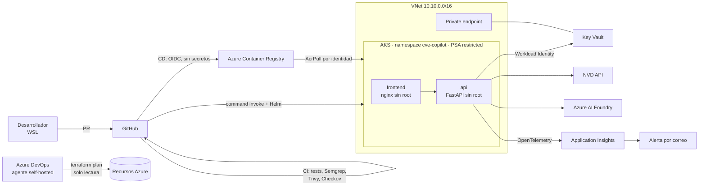

| Capa | Componentes |
|---|---|
| Infraestructura | Terraform (provider azurerm 5.x), state remoto cifrado con bloqueo y versionado |
| Red | VNet con subredes y NSG, Azure CNI Overlay + Cilium, private endpoint y DNS privado para Key Vault |
| Cómputo | AKS con autoescalado de nodos (1–3) y HPA por CPU (1–3 réplicas) |
| Identidad | Entra ID RBAC en el clúster, cuentas locales deshabilitadas, identidades administradas con credenciales federadas |
| Secretos | Key Vault montado en los pods vía Secrets Store CSI Driver y Workload Identity |
| Entrega | GitHub Actions (CI/CD), Azure DevOps (plan de Terraform), Helm |
| Observabilidad | Application Insights con OpenTelemetry, alerta de fallos, límite diario de ingesta |

---

## Pipeline de entrega

**En cada pull request (GitHub Actions):**

1. `test`: pruebas unitarias de la API.
2. `sast`: análisis estático con Semgrep.
3. `image-scan`: construye las dos imágenes y las escanea con Trivy; falla ante vulnerabilidades críticas o altas con parche disponible.
4. `iac-scan`: escanea Terraform con Checkov.
5. Si el PR toca `infra/terraform/`, Azure DevOps ejecuta `terraform plan` con una identidad de solo lectura.

La rama `main` está protegida por un ruleset sin excepciones (ni siquiera para el administrador): nada entra sin pasar los checks.

**Al hacer merge a `main` (GitHub Actions):**

1. **Build:** construye las imágenes con el hash del commit como tag, las escanea con Trivy **antes** de autenticarse en Azure, y solo si pasan las publica en el ACR.
2. **Deploy:** espera aprobación manual en el environment `production`, empaqueta el chart y despliega con Helm a través de `az aks command invoke`, con `--wait` para que el pipeline falle si los pods no quedan sanos.

Ninguna credencial de acceso está guardada en GitHub ni en Azure DevOps. Toda la autenticación usa **credenciales federadas OIDC**.

---

## Controles de seguridad

### Cadena de suministro
- Secretos bloqueados antes del commit con **gitleaks** (pre-commit).
- Actions fijadas por **SHA de commit** e imágenes de herramientas fijadas por **digest**, contra ataques por etiquetas mutables.
- **Dependabot** con *cooldown* de 7 días para no adoptar versiones maliciosas recién publicadas.
- Escaneo de vulnerabilidades obligatorio antes de publicar cualquier imagen.

### Identidades y accesos
- Cada identidad administrada tiene el mínimo privilegio para su tarea:

| Identidad | Uso | Permisos |
|---|---|---|
| kubelet (AKS) | Descargar imágenes | `AcrPull` |
| `id-api` | Leer secretos desde el pod | `Key Vault Secrets User` |
| `id-gh-build` | Publicar imágenes | `AcrPush` |
| `id-gh-deploy` | Desplegar | Rol personalizado solo con `runcommand` + `RBAC Admin` limitado al namespace |
| `id-ado-plan` | Terraform plan | `Reader` + acceso al state + `AKS Cluster User` |

- Las credenciales federadas usan el *subject* de GitHub con IDs numéricos inmutables, lo que impide reutilizar el nombre del repositorio para suplantarlo.

### Kubernetes
- Pod Security Admission en modo `restricted`: ningún pod puede correr como root ni escalar privilegios.
- Contenedores con sistema de archivos de solo lectura, sin capabilities y con perfil seccomp.
- NetworkPolicies con **denegación por defecto**: la API solo acepta tráfico del frontend.
- API del clúster restringida por IP y autenticación exclusiva con Entra ID.

### Datos y red
- Secretos solo en Key Vault; nunca en el código, en el state de Terraform ni en Secrets de Kubernetes.
- Key Vault accesible desde el clúster por private endpoint y desde administración solo por IP autorizada.

### Controles verificados intentando romperlos

| Prueba | Resultado esperado |
|---|---|
| Obtener credenciales de admin local del clúster | Rechazado: cuentas locales deshabilitadas |
| Desplegar un pod como root | Rechazado por Pod Security Admission |
| Conectar a la API desde un pod no autorizado | Timeout: bloqueado por NetworkPolicy |
| Hacer commit de una API key | Bloqueado por gitleaks |
| Publicar una imagen con un CVE alto | Bloqueado por Trivy en el pipeline |

Las excepciones a las reglas de Checkov y Semgrep están justificadas una por una en [`docs/security-exceptions.md`](docs/security-exceptions.md), con su control compensatorio y fecha de revisión.

---

## Incidentes reales durante la construcción

Problemas que aparecieron construyendo la plataforma y cómo se resolvieron:

- **Imagen vulnerable bloqueada antes de producción.** Trivy detectó `CVE-2026-4775` (HIGH) en la imagen del frontend y detuvo el pipeline antes de publicarla. Se corrigió actualizando los paquetes de la imagen base y se extendió el escaneo del CI a ambas imágenes, que antes solo cubría la API.
- **Bug de diseño detectado por el plan automatizado.** El primer `terraform plan` del pipeline mostró que los roles de administrador dependían de quién ejecutaba Terraform: aplicarlo habría revocado el acceso del administrador. Se corrigió declarando el administrador de forma explícita.
- **Falla solo en la nube.** La app funcionaba en local pero fallaba en AKS: la NVD trata distinto a las IPs de proveedores cloud. Se agregó manejo de errores de dependencias externas (502 controlado) y API key.
- **Despliegue sin caída bajo carga.** Durante una prueba de estrés, el CD desplegó una nueva versión mediante rolling update sin interrumpir el servicio.

---

## Observabilidad y validación

- **Application Insights** registra cada petición, su latencia y las dependencias externas (NVD y modelo de IA).
- **Alerta por correo** si hay más de 5 peticiones fallidas en 5 minutos.
- **Prueba de carga con k6** ejecutada dentro del clúster, respetando las NetworkPolicies. El HPA escaló la API de 1 a 3 réplicas al superar el 70% de CPU.

---

## Evidencias

| | |
|---|---|
| **Checks obligatorios en cada PR**<br>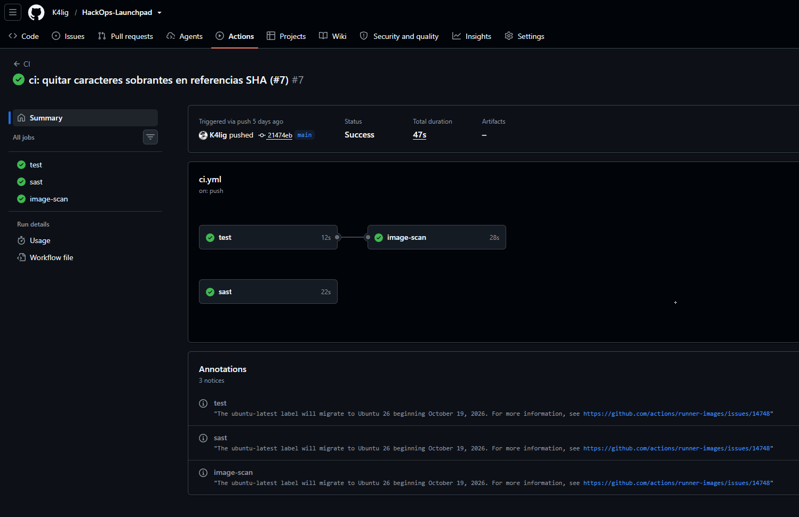 | **Trivy bloqueando una imagen vulnerable**<br>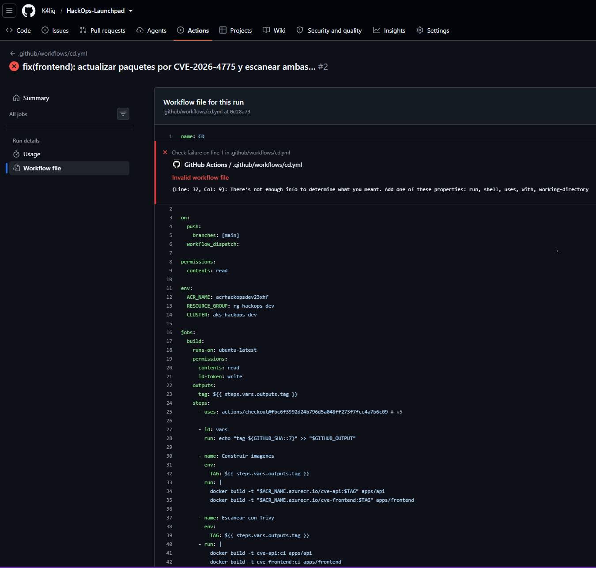 |
| **Semgrep detectando un riesgo de cadena de suministro**<br>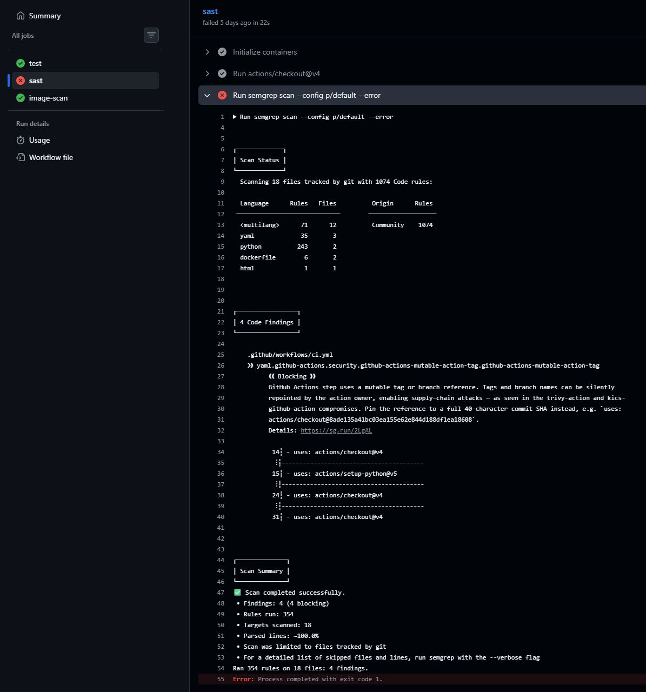 | **Aprobación manual antes de producción**<br>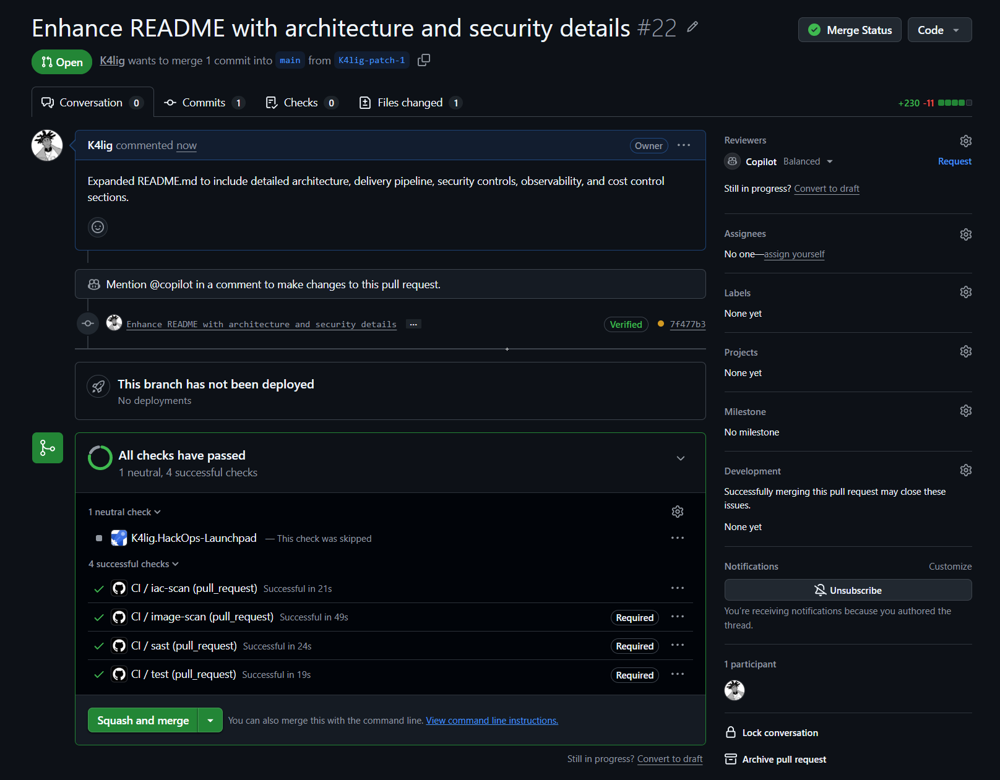 |
| **Despliegue exitoso sin secretos**<br>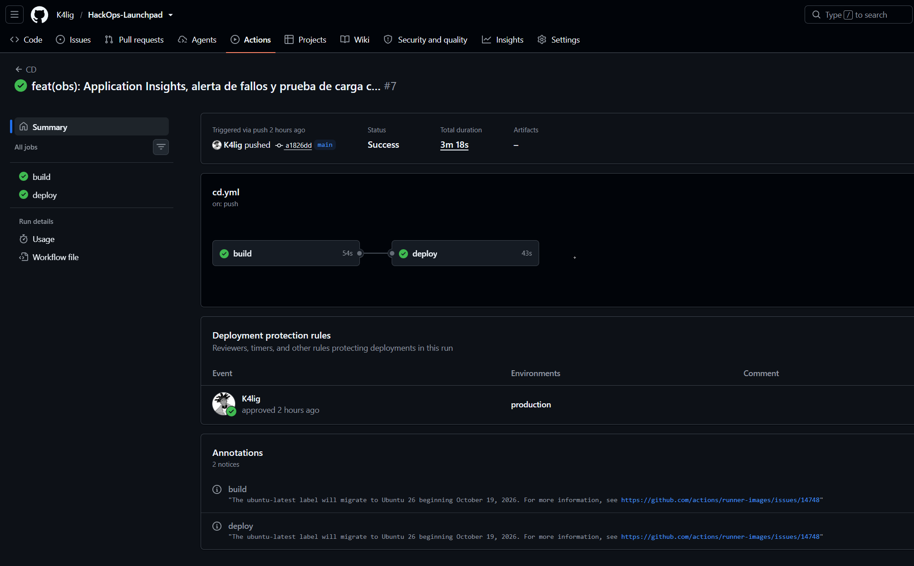 | **Terraform plan en Azure DevOps**<br>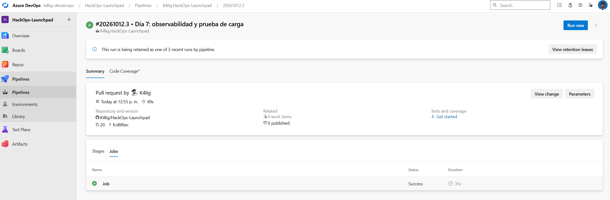 |
| **Credenciales de admin local rechazadas**<br>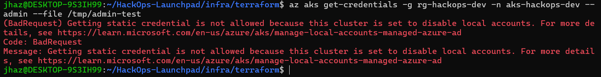 | **Pod como root rechazado por PSA**<br>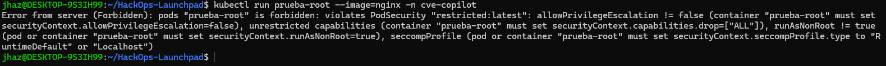 |
| **NetworkPolicy bloqueando tráfico**<br>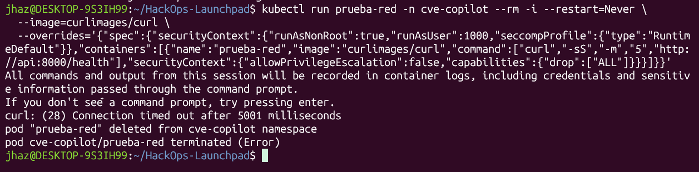 | **HPA escalando bajo carga**<br>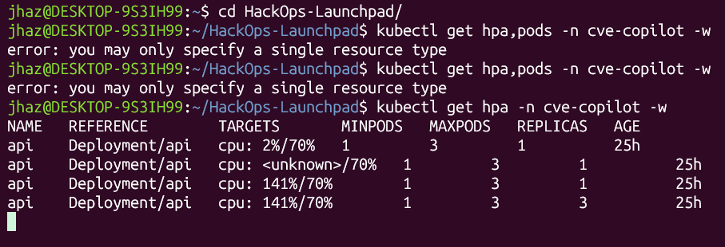 |
| **Rolling update durante la prueba de carga**<br>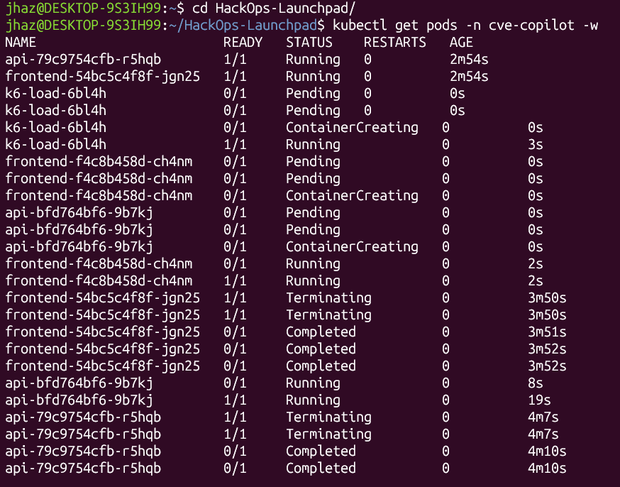 | **Application map**<br>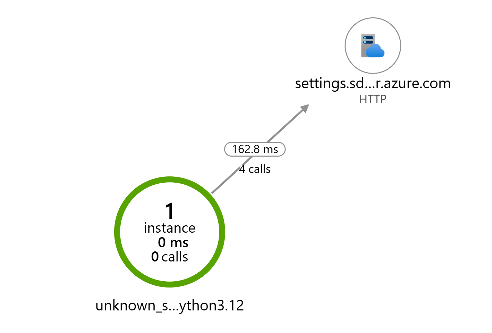 |

---

## Decisiones de arquitectura

| Decisión | Alternativa descartada | Motivo |
|---|---|---|
| `az aks command invoke` para desplegar | Abrir la API del clúster a los runners de GitHub | Los runners usan miles de IPs cambiantes; command invoke pasa por la API de Azure y mantiene la restricción por IP |
| Identidades separadas para build y deploy | Una sola identidad para el pipeline | Un compromiso en el build no puede tocar el clúster |
| Helm con checksum de configuración | Manifiestos estáticos | Un solo artefacto parametrizado; los cambios de configuración reinician los pods automáticamente |
| Namespace fuera del chart | Namespace dentro del chart | Una actualización de la app nunca puede modificar las reglas de seguridad del namespace |
| Plan automatizado, apply manual | Apply automatizado | El apply requiere permisos de alto privilegio; queda como siguiente paso con aprobación |
| ACR Basic con controles compensatorios | ACR Premium | Costo; el escaneo y la firma se cubren en el pipeline |

---

## Estructura del repositorio

```
.
├── apps/
│   ├── api/                 # FastAPI + OpenTelemetry
│   └── frontend/            # nginx sin privilegios
├── charts/cve-copilot/      # Helm: deployments, NetworkPolicies, HPA, Key Vault
├── infra/terraform/         # Toda la infraestructura de Azure
├── k8s/namespace.yaml       # Namespace con Pod Security Admission
├── azure-pipelines/         # Plan de Terraform en Azure DevOps
├── .github/workflows/       # CI y CD
├── tests/load/              # Prueba de carga k6
├── scripts/                 # Bootstrap del state remoto
└── docs/                    # Excepciones de seguridad y evidencias
```

---

## Cómo reproducirlo

Requisitos: Azure CLI, Terraform, kubectl, kubelogin, Helm y Docker.

```bash
# 1. State remoto (una sola vez)
bash scripts/bootstrap-state.sh

# 2. Infraestructura
cd infra/terraform
cp terraform.tfvars.example terraform.tfvars   # completar valores
export ARM_SUBSCRIPTION_ID=$(az account show --query id -o tsv)
terraform init && terraform plan -out tfplan && terraform apply tfplan

# 3. Secretos (se cargan fuera de Terraform para que no queden en el state)
read -s LLM_KEY && az keyvault secret set --vault-name <kv> --name llm-api-key --value "$LLM_KEY"

# 4. Namespace y conexión al clúster
az aks get-credentials -g rg-hackops-dev -n aks-hackops-dev
kubelogin convert-kubeconfig -l azurecli
kubectl apply -f k8s/namespace.yaml
```

A partir de ahí, cada merge a `main` despliega automáticamente.

Desarrollo local: `docker compose up --build` y abrir `http://localhost:3000`. El archivo `.env` (ver `.env.example`) solo se usa en local; en el clúster la configuración viene de `charts/cve-copilot/values.yaml` y los secretos de Key Vault.

---

## Control de costos

- AKS en tier gratuito, un nodo pequeño y apagado (`az aks stop`) cuando no se usa.
- Presupuesto con alertas al 50% y 90%.
- Límite diario de ingesta de 1 GB en Log Analytics.
- La prueba de carga evita llamar al modelo de IA para no generar costo de tokens.

---

## Limitaciones conocidas y siguientes pasos

- **Ingress público con TLS** (hoy el acceso es por `port-forward`).
- **Apply de Terraform automatizado** con aprobación, usando una identidad dedicada de mayor privilegio.
- **Firma de imágenes** con Cosign y verificación en el clúster con Kyverno.
- **DAST** con OWASP ZAP sobre el entorno desplegado.
- **NetworkPolicies de salida** (hoy se controla solo el tráfico entrante).
- **Acceso administrativo desde IP fija** (VPN o máquina de salto): con una IP residencial dinámica, el acceso al clúster se interrumpe cuando cambia la IP.
- **Entorno híbrido** con Azure Arc para administrar un clúster on-premise con los mismos manifiestos.

---

## Autor

**Jandry Cabezas** · Ingeniero en Tecnologías de la Información · Cloud Security y DevSecOps
