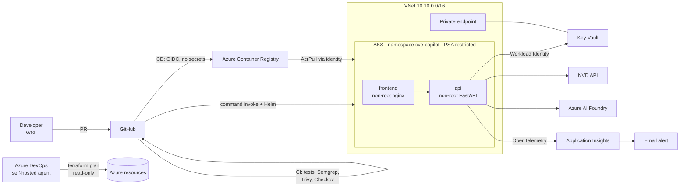

# HackOps Launchpad

> 🇪🇸 [Versión en español](README.es.md)

A DevSecOps platform on Azure that takes an AI prototype from idea to production in a fast, secure and repeatable way.

The sample workload is **CVE Copilot**, an assistant that queries NIST's National Vulnerability Database (NVD) and uses an AI model on Azure AI Foundry to explain each CVE in plain language: what it is, its impact and how to mitigate it.

The focus is not the app itself but the platform around it: infrastructure as code, secretless CI/CD, hardened Kubernetes, observability, and security controls verified at every stage.

<!-- Demo GIF: uncomment once docs/evidence/demo.gif exists

-->

---

## Architecture



| Layer | Components |
|---|---|
| Infrastructure | Terraform (azurerm provider 5.x), encrypted remote state with locking and versioning |
| Network | VNet with subnets and NSGs, Azure CNI Overlay + Cilium, private endpoint and private DNS for Key Vault |
| Compute | AKS with node autoscaling (1–3) and CPU-based HPA (1–3 replicas) |
| Identity | Entra ID RBAC on the cluster, local accounts disabled, managed identities with federated credentials |
| Secrets | Key Vault mounted into pods through the Secrets Store CSI Driver and Workload Identity |
| Delivery | GitHub Actions (CI/CD), Azure DevOps (Terraform plan), Helm |
| Observability | Application Insights with OpenTelemetry, failure alert, daily ingestion cap |

---

## Delivery pipeline

**On every pull request (GitHub Actions):**

1. `test`: API unit tests.
2. `sast`: static analysis with Semgrep.
3. `image-scan`: builds both images and scans them with Trivy; fails on critical or high vulnerabilities that have a fix available.
4. `iac-scan`: scans Terraform with Checkov.
5. If the PR touches `infra/terraform/`, Azure DevOps runs `terraform plan` with a read-only identity.

The `main` branch is protected by a ruleset with no bypass, not even for the admin: nothing gets in without passing the checks.

**On merge to `main` (GitHub Actions):**

1. **Build:** builds the images tagged with the commit hash, scans them with Trivy **before** authenticating to Azure, and only pushes them to ACR if they pass.
2. **Deploy:** waits for manual approval on the `production` environment, packages the chart and deploys it with Helm through `az aks command invoke`, using `--wait` so the pipeline fails if the pods don't become healthy.

No access credentials are stored in GitHub or Azure DevOps. All authentication uses **OIDC federated credentials**.

---

## Security controls

### Supply chain
- Secrets blocked before commit with **gitleaks** (pre-commit).
- Actions pinned by **commit SHA** and tool images pinned by **digest**, preventing mutable-tag attacks.
- **Dependabot** with a 7-day *cooldown* to avoid adopting freshly published malicious versions.
- Mandatory vulnerability scanning before any image is published.

### Identity and access
- Each managed identity has the least privilege required for its task:

| Identity | Purpose | Permissions |
|---|---|---|
| kubelet (AKS) | Pull images | `AcrPull` |
| `id-api` | Read secrets from the pod | `Key Vault Secrets User` |
| `id-gh-build` | Publish images | `AcrPush` |
| `id-gh-deploy` | Deploy | Custom role with only `runcommand` + `RBAC Admin` scoped to the namespace |
| `id-ado-plan` | Terraform plan | `Reader` + state access + `AKS Cluster User` |

- Federated credentials use GitHub's subject format with immutable numeric IDs, so the repository name can't be reused to impersonate it.

### Kubernetes
- Pod Security Admission in `restricted` mode: no pod can run as root or escalate privileges.
- Containers with read-only root filesystem, all capabilities dropped and a seccomp profile.
- **Default-deny** NetworkPolicies: the API only accepts traffic from the frontend.
- Cluster API restricted by IP, with Entra ID as the only authentication method.

### Data and network
- Secrets live only in Key Vault; never in code, in Terraform state or in Kubernetes Secrets.
- Key Vault reachable from the cluster through a private endpoint and from administration only through an allowed IP.

### Controls verified by trying to break them

| Test | Expected result |
|---|---|
| Fetch the cluster's local admin credentials | Denied: local accounts disabled |
| Deploy a pod running as root | Denied by Pod Security Admission |
| Reach the API from an unauthorized pod | Timeout: blocked by NetworkPolicy |
| Commit an API key | Blocked by gitleaks |
| Publish an image with a high-severity CVE | Blocked by Trivy in the pipeline |

Every Checkov and Semgrep exception is justified one by one in [`docs/security-exceptions.md`](docs/security-exceptions.md), with its compensating control and review date.

---

## Real incidents during the build

Issues that came up while building the platform and how they were solved:

- **Vulnerable image blocked before production.** Trivy detected `CVE-2026-4775` (HIGH) in the frontend image and stopped the pipeline before publishing it. Fixed by upgrading the base image packages, and CI scanning was extended to both images (it previously covered only the API).
- **Design bug caught by the automated plan.** The pipeline's first `terraform plan` showed that the admin role assignments depended on who ran Terraform: applying it would have revoked the administrator's access. Fixed by declaring the administrator explicitly.
- **Cloud-only failure.** The app worked locally but failed on AKS: the NVD treats cloud provider IPs differently. Added graceful handling of external dependency failures (controlled 502) and an API key.
- **Zero-downtime deploy under load.** During a stress test, CD rolled out a new version through a rolling update without interrupting the service.

---

## Observability and validation

- **Application Insights** records every request, its latency and external dependencies (NVD and the AI model).
- **Email alert** when there are more than 5 failed requests within 5 minutes.
- **k6 load test** run inside the cluster while respecting the NetworkPolicies. The HPA scaled the API from 1 to 3 replicas once CPU exceeded 70%.

---

## Evidence

| | |
|---|---|
| **Required checks on every PR**<br> | **Trivy blocking a vulnerable image**<br> |
| **Semgrep catching a supply-chain risk**<br> | **Manual approval before production**<br> |
| **Successful secretless deploy**<br> | **Terraform plan in Azure DevOps**<br> |
| **Local admin credentials denied**<br> | **Root pod denied by PSA**<br> |
| **NetworkPolicy blocking traffic**<br> | **HPA scaling under load**<br> |
| **Rolling update during load test**<br> | **Application map**<br> |

---

## Architecture decisions

| Decision | Rejected alternative | Rationale |
|---|---|---|
| `az aks command invoke` for deployments | Opening the cluster API to GitHub runners | Runners use thousands of changing IPs; command invoke goes through the Azure API and keeps the IP restriction intact |
| Separate identities for build and deploy | A single pipeline identity | A compromised build step can't touch the cluster |
| Helm with a config checksum | Static manifests | A single parameterized artifact; config changes restart pods automatically |
| Namespace outside the chart | Namespace inside the chart | An app upgrade can never modify the namespace's security rules |
| Automated plan, manual apply | Automated apply | Apply needs high-privilege permissions; planned as a next step behind approval |
| ACR Basic with compensating controls | ACR Premium | Cost; scanning and signing are covered in the pipeline |

---

## Repository structure

```
.
├── apps/
│   ├── api/                 # FastAPI + OpenTelemetry
│   └── frontend/            # Unprivileged nginx
├── charts/cve-copilot/      # Helm: deployments, NetworkPolicies, HPA, Key Vault
├── infra/terraform/         # All Azure infrastructure
├── k8s/namespace.yaml       # Namespace with Pod Security Admission
├── azure-pipelines/         # Terraform plan on Azure DevOps
├── .github/workflows/       # CI and CD
├── tests/load/              # k6 load test
├── scripts/                 # Remote state bootstrap
└── docs/                    # Security exceptions and evidence
```

---

## How to reproduce

Requirements: Azure CLI, Terraform, kubectl, kubelogin, Helm and Docker.

```bash
# 1. Remote state (one time only)
bash scripts/bootstrap-state.sh

# 2. Infrastructure
cd infra/terraform
cp terraform.tfvars.example terraform.tfvars   # fill in values
export ARM_SUBSCRIPTION_ID=$(az account show --query id -o tsv)
terraform init && terraform plan -out tfplan && terraform apply tfplan

# 3. Secrets (loaded outside Terraform so they never land in state)
read -s LLM_KEY && az keyvault secret set --vault-name <kv> --name llm-api-key --value "$LLM_KEY"

# 4. Namespace and cluster access
az aks get-credentials -g rg-hackops-dev -n aks-hackops-dev
kubelogin convert-kubeconfig -l azurecli
kubectl apply -f k8s/namespace.yaml
```

From then on, every merge to `main` deploys automatically.

Local development: `docker compose up --build` and open `http://localhost:3000`. The `.env` file (see `.env.example`) is only used locally; in the cluster, configuration comes from `charts/cve-copilot/values.yaml` and secrets from Key Vault.

---

## Cost control

- AKS on the free tier, a single small node, stopped (`az aks stop`) when not in use.
- Budget with alerts at 50% and 90%.
- 1 GB daily ingestion cap on Log Analytics.
- The load test avoids calling the AI model so it generates no token cost.

---

## Known limitations and next steps

- **Public Ingress with TLS** (access is currently through `port-forward`).
- **Automated Terraform apply** behind approval, with a dedicated higher-privilege identity.
- **Image signing** with Cosign and in-cluster verification with Kyverno.
- **DAST** with OWASP ZAP against the deployed environment.
- **Egress NetworkPolicies** (only inbound traffic is controlled today).
- **Admin access from a static IP** (VPN or jump box): with a dynamic residential IP, cluster access breaks whenever the IP changes.
- **Hybrid environment** with Azure Arc to manage an on-premises cluster with the same manifests.

---

## Author

**Jandry Cabezas** · IT Engineer · Cloud Security & DevSecOps
